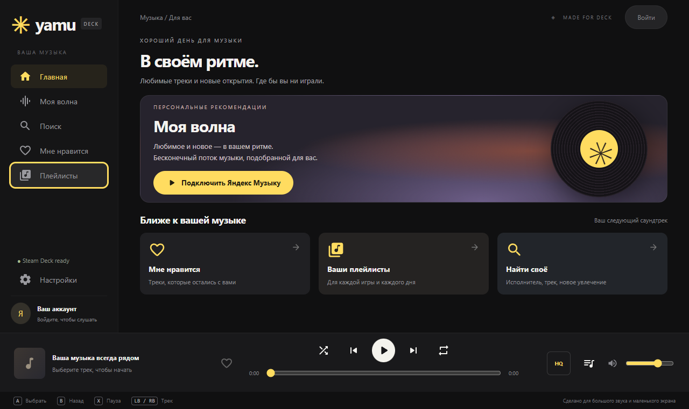

# Yamu Deck

[English](README.en.md) · [Русский](README.md)

**Yandex Music on Steam Deck — with My Wave, gamepad controls, and selectable audio quality.**

An unofficial desktop client for SteamOS / Linux x86_64 and Windows. Its minimalist dark interface takes inspiration from the Yandex Music website and fits the Steam Deck's 1280×800 screen. The entire home screen is visible without scrolling.



## Features

- **My Wave:** personalized recommendations, automatic queue replenishment, and listening and skip feedback. Pressing Play on the home screen starts My Wave when no track is selected.
- **Your collection:** track search, your playlists, the latest 500 liked tracks, and adding or removing likes.
- **Audio quality:** standard MP3 up to 192 kbps, high-quality MP3 up to 320 kbps, and lossless FLAC when available for your account and the track. The actual format and bitrate appear below the seek bar.
- **Playback controls:** queue, pause, previous and next track, seeking, volume, shuffle for regular queues, and single-track repeat.
- **Deck controls:** gamepad, touchscreen, mouse, and keyboard. Large buttons, visible focus indicators, and a layout that adapts to window height.
- **System media controls:** MPRIS on Linux and Media Session integration. Quick Access Menu controls require a compatible Decky Music Control plugin.
- **Yandex sign-in:** OAuth device code confirmation on your phone or in a browser, with manual OAuth token entry as a fallback.
- **Google Material Rounded icons:** bundled SVGs with no font downloads or runtime requests to Google for icons.

## Project status

The current version is **0.3.2**, an early release under active development. The interface and playback workflows have been tested on Windows; API tests use a simulated service. Linux archives and Windows portable builds have been prepared. A GitHub Actions workflow is configured to build an AppImage on Linux.

**Full compatibility with a physical Steam Deck has not yet been verified.** Gaming Mode, SteamOS credential storage, and integration with current Steam/Decky versions still require testing on the device. This project is not Valve-certified and is not affiliated with Yandex.

The current application interface is in Russian. This file provides English documentation, not an English UI localization. Screenshots and some linked technical documents are also in Russian.

## Installation

The following files have been prepared for version 0.3.2. They can be attached to GitHub Releases; the `dist/` directory is excluded from Git.

| Platform | File |
|---|---|
| Steam Deck / Linux x86_64 | `yamu-deck-0.3.2.tar.gz` |
| Windows x64, portable | `Yamu 0.3.2.exe` |

### Steam Deck

1. In Desktop Mode, extract the Linux archive into a permanent directory, such as `/home/deck/Applications/Yamu`.
2. Open a terminal in the extracted directory containing `start-yamu.sh`:

   ```sh
   chmod +x start-yamu.sh
   ./start-yamu.sh --fullscreen
   ```

3. Request a sign-in code in the app and confirm it at `https://oauth.yandex.ru/device` on your phone or in a browser.
4. Add `start-yamu.sh` to Steam as a non-Steam game. Set the working directory to the script's directory and add `--fullscreen` to the launch options.
5. Select the Steam Input **Gamepad** layout. **Do not enable Proton:** use the Linux build.
6. Launch Yamu from Gaming Mode. To keep listening in the background, switch to your game through the Steam menu while leaving Yamu running.

### Windows

Run `Yamu 0.3.2.exe`. No installation is required. Settings and the encrypted session are stored in the Electron user profile. The build is not currently digitally signed.

### Steam Deck Quick Access Menu

Controls in the `…` menu require **Decky Loader and a compatible Music Control plugin**. Launch the Linux version of Yamu from Gaming Mode, start playback, and select Yamu in the plugin panel. Steam's built-in music tab is not a supported integration for this app.

See the [Quick Access Menu setup and troubleshooting guide](docs/steam-deck-media.md) (Russian).

## Controls

| Button | Action |
|---|---|
| D-pad / left stick | Navigate |
| A | Select |
| B | Close a dialog or queue / return home |
| X | Pause / resume; start My Wave from an empty home screen |
| Y | Search |
| LB / RB | Previous / next track |
| Steam + X | Steam on-screen keyboard |
| Arrow keys / Enter | Keyboard navigation / select |
| Space / Escape | Play or pause / back |

On sliders, D-pad left and right change the value. Pressing the queue button again returns to the previous screen.

## Audio quality

Choose a quality level in Settings or use the format button next to the queue. Your preference is saved and applies to the next track.

If FLAC is unavailable, the app displays a notice and uses MP3. High quality selects the best available MP3 variant. The label below the seek bar shows the quality of the actual stream, rather than just your selected preference. A preview is never substituted for a full track.

## Authentication and security

The app never asks for your Yandex password. With device code sign-in, the access token stays in Electron's main process. If you enter a token manually, the input field is cleared immediately after it is passed to the main process.

Sessions are stored using Electron safeStorage. If secure storage is unavailable on Linux (`basic_text`), the token is not written to disk and you must sign in again after closing the app. The token is not placed in URLs, localStorage, or application logs. localStorage contains volume and quality preferences.

The renderer runs in a sandbox with context isolation and Node.js integration disabled. System media panels receive track information without the token or signed audio URL. These protections do not cover a compromised operating system or access to the app's memory.

See the [security review](SECURITY.md) (Russian).

## Building from source

Node.js 24 and npm are required. Use Linux x86_64 for Linux builds and Windows x64 for Windows builds.

```sh
npm ci
npm start
```

| Command | Purpose |
|---|---|
| `npm test` | API, MPRIS, and data-filtering tests |
| `npm run test:ui` | Electron UI checks; requires a graphical session |
| `npm run test:features` | My Wave, quality, and media command workflows with a simulated service |
| `dbus-run-session -- npm run test:mpris` | Real D-Bus session integration test on Linux |
| `npm run dist:linux` | Build an AppImage |
| `npm run dist:win` | Build a Windows portable executable |
| `npx electron-builder --linux tar.gz --x64` | Build a Linux archive |

Output is written to `dist/`. The [build.yml](.github/workflows/build.yml) workflow is configured to run tests, build an AppImage on Ubuntu, and upload the artifact. Automatic publishing to GitHub Releases is not configured.

## Limitations

- Yamu uses an **unofficial Yandex Music API**. Endpoints and the OAuth flow may change without notice. This is not an official SDK or partner integration.
- Full tracks and lossless audio may require a subscription and the appropriate access rights. Availability depends on your account, region, and the track.
- Offline downloads, lyrics, a dedicated podcast interface, and playlist creation are not implemented.
- The liked-tracks collection is limited to the latest 500 tracks.
- My Wave mood settings are not implemented, and recommendations are not guaranteed to match the web client exactly.
- FLAC uses the `raw` transport. If only an encrypted `encraw` stream is available, the app falls back to MP3 with a notice.
- AppImage packaging could not be completed in the Windows development environment because of symbolic-link restrictions. The Linux archive was built on Windows; running it on SteamOS still requires testing. Use a Linux environment to build the AppImage.

## Feedback

When reporting a bug, include your Yamu version, operating system, launch mode, steps to reproduce, and expected behavior. For Steam Deck Quick Access Menu issues, also include your SteamOS, Steam, and Decky versions.

**Do not attach your password, OAuth token, `session.enc` file, or complete signed audio URLs.**

## Acknowledgments

- [yandex-music-api](https://github.com/MarshalX/yandex-music-api) — information about unofficial API methods and authentication.
- [Google Material Design Icons](https://github.com/google/material-design-icons) — Material Icons Rounded, licensed under Apache-2.0; license files are included in [ui/licenses](ui/licenses/).
- [Electron](https://www.electronjs.org/) — the desktop application framework.
- [MPRIS](https://specifications.freedesktop.org/mpris/latest/) and [dbus-next](https://github.com/JellyBrick/node-dbus-next) — Linux system media integration.
