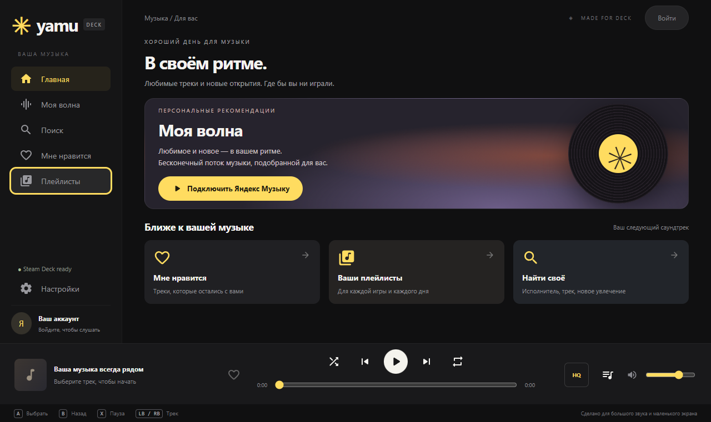

# Yamu Deck

[Русский](README.md) · [English](README.en.md)

[Скачать последнюю сборку](https://github.com/Sicky/YaMu-Deck/releases/tag/v0.3.2)

**Яндекс Музыка на Steam Deck — с «Моей волной», управлением геймпадом и выбором качества звука.**

Неофициальный настольный клиент для SteamOS / Linux x86_64 и Windows. Минималистичный тёмный интерфейс, вдохновлённый веб-версией Яндекс Музыки, адаптирован к экрану Steam Deck 1280×800. Главная страница целиком помещается на экране без прокрутки.



## Возможности

- **Моя волна:** персональные рекомендации, автоматическое пополнение очереди и учёт событий прослушивания и пропуска. Play на главной запускает волну, если трек ещё не выбран.
- **Ваша коллекция:** поиск треков, собственные плейлисты, последние 500 избранных треков, добавление и удаление лайков.
- **Качество звука:** обычное MP3 до 192 кбит/с, высокое до 320 кбит/с и Lossless FLAC при доступности для аккаунта и трека. Фактический формат и битрейт отображаются под полосой перемотки.
- **Плеер:** очередь, пауза, переключение треков, перемотка, громкость, перемешивание обычной очереди и повтор трека.
- **Управление на Deck:** геймпад, сенсорный экран, мышь и клавиатура. Крупные кнопки, видимый фокус и адаптация к высоте окна.
- **Системные медиакоманды:** MPRIS в Linux и Media Session. Управление через панель `…` — с совместимым Decky Music Control.
- **Вход через Яндекс:** OAuth-код устройства с подтверждением на телефоне или в браузере; резервный ввод OAuth-токена.
- **Иконки Google Material Rounded:** встроенные SVG без загрузки шрифтов и обращения к Google при работе.

## Статус проекта

Текущая версия — **0.3.2**, ранняя версия в активной разработке. Интерфейс и сценарии плеера проверялись на Windows; тесты API используют имитацию сервиса. Подготовлены Linux-архив и Windows portable; для AppImage настроена сборка в Linux через GitHub Actions.

**Полная совместимость с физическим Steam Deck пока не подтверждена.** Gaming Mode, хранилище SteamOS и управление через актуальные Steam/Decky требуют проверки на устройстве. Проект не сертифицирован Valve и не связан с Яндексом.

## Установка

Готовые сборки доступны в [GitHub Releases](https://github.com/Sicky/YaMu-Deck/releases/tag/v0.3.2). Каталог `dist/` исключён из Git.

| Платформа | Файл |
|---|---|
| Steam Deck / Linux x86_64 | `yamu-deck-0.3.2.tar.gz` |
| Windows x64, portable | `Yamu.0.3.2.exe` |
| Steam Deck / Linux x86_64, AppImage | `Yamu-0.3.2.AppImage` |

### Steam Deck

1. В Desktop Mode распакуйте Linux-архив в постоянную папку, например `/home/deck/Applications/Yamu`.
2. Откройте терминал в распакованном каталоге, где находится `start-yamu.sh`:

   ```sh
   chmod +x start-yamu.sh
   ./start-yamu.sh --fullscreen
   ```

3. Получите код входа в приложении и подтвердите его на `https://oauth.yandex.ru/device` с телефона или в браузере.
4. Добавьте `start-yamu.sh` в Steam как стороннюю игру. Рабочая папка — каталог скрипта, параметр запуска — `--fullscreen`.
5. Выберите раскладку Steam Input «Геймпад». **Proton не включайте:** используйте Linux-сборку.
6. Запускайте Yamu из Gaming Mode. Для фонового прослушивания переключитесь в игру через меню Steam, оставив плеер работающим.

### Windows

Запустите `Yamu.0.3.2.exe`. Установка не требуется. Настройки и защищённая сессия сохраняются в пользовательском профиле Electron. Сборка пока не подписана цифровым сертификатом.

### Быстрые настройки Steam Deck

Для управления через `…` нужны **Decky Loader и совместимый Music Control**. Запустите Linux-версию Yamu из Gaming Mode, включите музыку и выберите Yamu в панели плагина. Штатная вкладка музыки Steam не считается поддерживаемой интеграцией этого приложения.

Пошаговая настройка и диагностика: [управление из быстрых настроек](docs/steam-deck-media.md).

## Управление

| Кнопка | Действие |
|---|---|
| Крестовина / левый стик | Навигация |
| A | Выбор |
| B | Закрыть окно или очередь / вернуться на главную |
| X | Пауза / продолжение; запуск волны на пустой главной |
| Y | Поиск |
| LB / RB | Предыдущий / следующий трек |
| Steam + X | Экранная клавиатура Steam |
| Стрелки / Enter | Навигация / выбор с клавиатуры |
| Space / Escape | Воспроизведение или пауза / назад |

На ползунках крестовина влево/вправо меняет значение. Повторное нажатие кнопки очереди возвращает предыдущий экран.

## Качество звука

Выберите качество в настройках или через кнопку формата рядом с очередью. Настройка сохраняется и применяется со следующего трека.

Если FLAC недоступен, приложение сообщает об этом и использует MP3. Для высокого качества выбирается лучший доступный MP3-вариант. Под полосой перемотки показывается качество полученного потока, а не только выбранная настройка. Превью не подменяет полный трек.

## Авторизация и безопасность

Пароль Яндекса приложение не запрашивает. При входе через код устройства access token остаётся в основном процессе Electron. При ручном вводе поле токена очищается сразу после передачи в основной процесс.

Сессия сохраняется через Electron safeStorage. При отсутствии защищённого хранилища Linux (`basic_text`) токен не записывается на диск — после закрытия приложения потребуется повторный вход. Токен не включается в URL и не сохраняется в localStorage или журналы приложения. В localStorage хранятся громкость и выбор качества.

Интерфейс работает с песочницей и изоляцией контекста, без Node.js. Системным медиапанелям передаются сведения о треке, без токена и подписанной аудиоссылки. Защита не рассчитана на скомпрометированную ОС или доступ к памяти приложения.

Подробнее: [проверка безопасности](SECURITY.md).

## Сборка из исходников

Нужны Node.js 24 и npm. Для Linux-сборки используйте Linux x86_64; для Windows — Windows x64.

```sh
npm ci
npm start
```

| Команда | Назначение |
|---|---|
| `npm test` | Тесты API, MPRIS и фильтрации данных |
| `npm run test:ui` | Проверка интерфейса Electron; нужна графическая сессия |
| `npm run test:features` | Сценарии волны, качества и медиакоманд с имитацией сервиса |
| `dbus-run-session -- npm run test:mpris` | Проверка реальной D-Bus-сессии на Linux |
| `npm run dist:linux` | Сборка AppImage |
| `npm run dist:win` | Сборка Windows portable |
| `npx electron-builder --linux tar.gz --x64` | Сборка Linux-архива |

Результат появится в `dist/`. Workflow [build.yml](.github/workflows/build.yml) настроен для тестирования и сборки AppImage в Ubuntu с сохранением артефакта. Автоматическая публикация GitHub Releases не настроена.

## Ограничения

- Используется **неофициальный API** Яндекс Музыки. Методы и OAuth-сценарий могут измениться без предупреждения; это не официальный SDK и не партнёрская интеграция.
- Для полных треков и Lossless могут требоваться подписка и соответствующие права. Доступность зависит от аккаунта, региона и композиции.
- Нет офлайн-загрузки, текстов песен, отдельного интерфейса подкастов и создания плейлистов.
- Коллекция избранного ограничена последними 500 треками.
- Настройки настроения «Моей волны» не реализованы; точное совпадение рекомендаций с веб-клиентом не гарантируется.
- Для FLAC используется транспорт `raw`; если доступен только зашифрованный поток `encraw`, выбирается MP3 с уведомлением.
- AppImage в Windows-среде разработки не был получен из-за ограничения на символические ссылки. Linux-архив собран на Windows; его запуск на SteamOS требует проверки. Для AppImage используйте Linux-сборку.

## Обратная связь

При сообщении об ошибке укажите версию Yamu, ОС, режим запуска, последовательность действий и ожидаемый результат. Для Steam Deck добавьте версии SteamOS, Steam и Decky, если проблема связана с панелью `…`.

**Не прикладывайте пароль, OAuth-токен, файл `session.enc` или полные подписанные аудиоссылки.**

## Благодарности

- [yandex-music-api](https://github.com/MarshalX/yandex-music-api) — сведения о методах неофициального API и авторизации.
- [Google Material Design Icons](https://github.com/google/material-design-icons) — иконки Material Icons Rounded; Apache-2.0, лицензия включена в [ui/licenses](ui/licenses/).
- [Electron](https://www.electronjs.org/) — настольная оболочка приложения.
- [MPRIS](https://specifications.freedesktop.org/mpris/latest/) и [dbus-next](https://github.com/JellyBrick/node-dbus-next) — системное управление музыкой в Linux.
